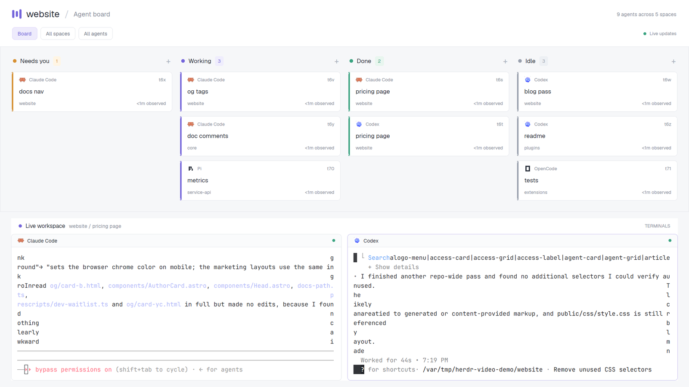

# Board

Agents as cards in four columns: Needs you, Working, Done and Idle.
Click a card to bring its tab's live terminals into the workspace below.

## What's in here

- `layouts/board.json`: a header, 355px board and the active tab's
  terminals underneath.
- `mods/board/`: one mod with `props().role` for `header`,
  `terminals` (workspace title), `pane` (terminal headers), or no
  role (the cards). Includes a layout preview SVG.

## How it was built

1. `agents()` fills the four status columns across all spaces.
   Cards show program, address, tab, space and time observed in that state.
2. A 30s timer updates those ages. They start when this copy first sees
   the state, not when the agent actually began work.
3. Card clicks run `agent.focus`; `setAgentOrder` makes agent
   navigation follow column order.
4. `spaces()` names the project and active tab; `panes()` supplies
   each terminal header's program and status. Columns scroll separately.

## What it assumes

- Only built-in Herdr data and commands; no shipped mod or external CLI.
- `Geist` UI font and a light `paper` theme with white, gray and
  violet overrides. The mod also hardcodes its colors.
- Board/filter chips and column plus signs are decoration, not filters
  or task creation. There is no card dragging.
- The fixed-height board leaves the remaining window height for terminals.
- No existing `layouts/board.json` or `mods/board/`; rename the
  references and asset paths first if those names are taken.

