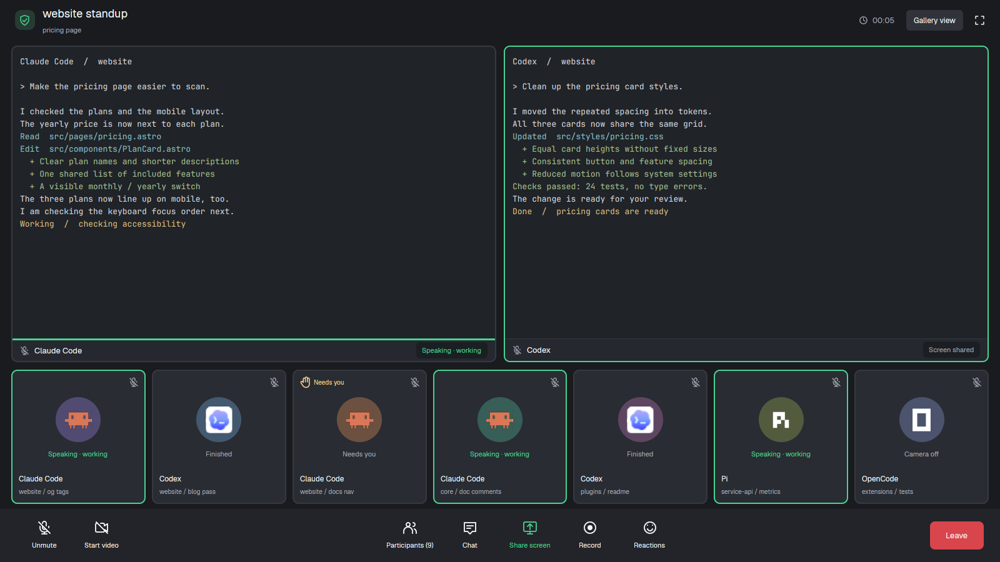

# Call

A pretend team call with live terminals as shared screens. Agents in other
tabs sit in the gallery; working ones speak, and blocked ones raise a hand.

This file is the brief: enough to build Call from an empty folder. The
files next to it are one build of it. If they don't work on your Herdr, or you
want it different, build it again from here.

## What you see

Four regions, top to bottom, filling the window (no title bar):

1. **The meeting title**, 65px. A green shield beside “space standup”
   (18px, semibold), with the active tab's name underneath. On the right:
   an elapsed clock, “Gallery view” and an expand icon.
2. **Shared screens**, the remaining flexible height. The active tab's
   real terminals, with 12px gaps, 10px corners and 2px gray borders
   (`#363940`), green when focused. Each has a 36px bottom label with a
   muted microphone, program name and speaking/screen-sharing pill.
3. **The gallery**, 215px, one row of equal-width participant cards with
   10px gaps. Each card has a muted microphone, a program icon (43px) in
   a colored 72px circle, status text, program name and “space / tab”.
4. **The toolbar**, 85px, dark gray (`#222429`). Unmute and Start video
   on the left; Participants with the real agent count, Chat, green Share
   screen, Record and Reactions in the middle; a red Leave button on the right.

Colors: background `#191b1f`, gallery cards `#292c32`, terminal background
`#202328`, text `#f4f5f7`, muted `#a9adb6`, green `#49d392`, Leave
`#d9454d`. Text in Geist; terminal text is 13px.

## How it behaves

| Status | Gallery |
| --- | --- |
| working | green border and “Speaking · working” in green |
| blocked | raised hand and “Needs you” above the avatar, “Needs you” below |
| done | “Finished” |
| idle | “Camera off” |

- The gallery shows agents outside the focused tab. Clicking a participant
  selects its space and tab, bringing its terminals into the shared screens
  and moving that tab's agents out of the gallery.
- Working shared screens have a 3px green line above their bottom label and
  “Speaking · working”. Blocked screens say “Needs you”; others say
  “Screen shared”.
- The meeting clock counts minutes and seconds from when its title first
  starts, updating each second. The title and tab name follow selection.
- The app's next/previous agent keys use all agents in their usual order,
  including those currently sharing screens.

## Built from

- **The layout** (`layouts/call.json`): a root `column`, `titlebar: "none"`,
  `theme: "graphite"`, its own colors, and fixed top and toolbar `block`s.
  Between them, a `column` with padding `[8, 18]` and 12px gaps holds
  `content: { tab: "active", pane: { … } }` and the fixed gallery block.
  `pane.lone: true` frames a single terminal too; terminal padding is `[12, 10]`.
- **One mod** (`mods/call/`), using `props().role`: `top`, `gallery`, `pane`
  or `toolbar` (also the default). Pane labels use `props().pane`.
- **Data:** `spaces()` for title and tab, `panes()` for shared-screen labels,
  `agents()` for participants, `focused().tab` for the gallery exclusion.
- **Commands and time:** `run("agent.focus", { terminal })` on participant
  clicks; `setAgentOrder()` in gallery renders. Only the `top` copy runs
  a 1,000ms clock timer.
- **Art:** local outline SVGs for shield, clock, expand, microphone, video,
  people, chat, share, record, smile and hand; program icons respect tint.
  A preview SVG and `place: "none"` manifest accompany the mod. No shipped
  mod, external program or call service is needed.

## Watch out

- This is not an audio or video client. Every toolbar control, including
  Participants and Leave, is decoration. Gallery view and expand do nothing.
- The muted microphones do not describe a real microphone's state.
- Gallery cards share one row without scrolling. Many agents squeeze into
  the same space; the toolbar also needs a wide window.
- The layout and mod hardcode their dark palette.
- If `call` is taken, rename its layout/mod references and every
  `mods/call/…` asset path before installing.

## Done when

- Other tabs' agents appear with the right status and real program icons.
- Clicking a participant shows its terminals and updates title and gallery.
- The clock advances, and working screen labels show the green speaking line.
- `herdr-app check mods/call` passes, and switching away and back works.
