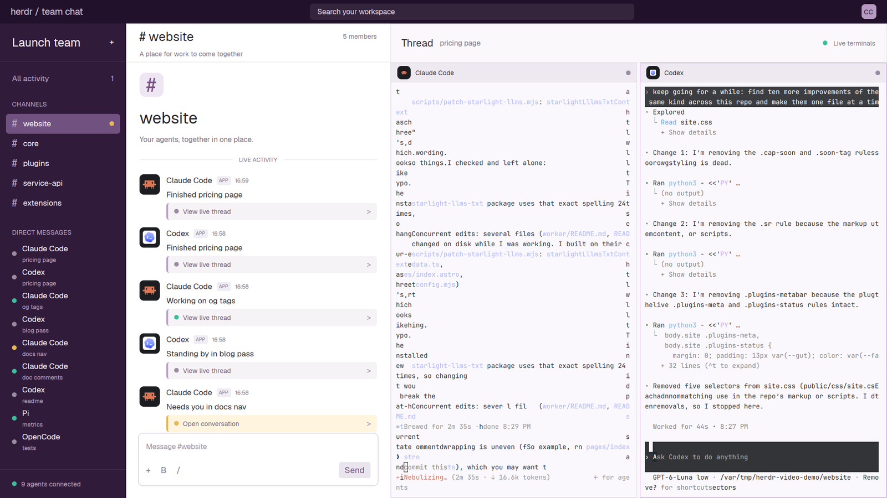

# Chat

Spaces look like channels and agents look like teammates posting updates.
Open an agent's thread to see its tab's real terminals on the right.

This file is the brief: enough to build Chat from an empty folder. The
files next to it are one build of it. If they don't work on your Herdr, or you
want it different, build it again from here.

## What you see

A 39px top bar over three columns, filling the window (no title bar):

1. **The top bar**, deep purple (`#22112b`): “herdr / team chat” on the
   left, a 540px search-shaped box in the middle and a small “CC” avatar.
2. **The sidebar**, 210px, purple (`#311b3b`). “Launch team” and a plus
   sign above All activity with a blocked-agent count. CHANNELS lists each
   space with a #; the active one has a lighter purple background
   (`#715180`). DIRECT MESSAGES lists all agents with a status dot,
   program name and tab name. The bottom says how many agents are connected.
3. **The feed**, 440px, white. A 65px heading names the active channel and
   member count. Below: a large #, channel name, welcome line and LIVE
   ACTIVITY divider. Each agent has a colored program avatar, program name,
   APP badge, clock time, status sentence and a thread link. The feed scrolls.
   A message-shaped box with formatting marks and Send sits at the bottom.
4. **The thread**, the remaining width. A 65px heading says “Thread”, the
   active tab's name and “Live terminals”. Below are that tab's terminals,
   pale purple (`#faf8fc`), separated by 5px gaps. Their 32px headers show
   a program icon, program name and status dot on `#eee8f1`.

Colors: ink `#27232b`, muted `#817888`, lines `#e8e3ea`, sidebar muted
`#b9a6c4`. Text in Geist; terminal text is 11px.

## How it behaves

| Status | Feed sentence | Dot |
| --- | --- | --- |
| working | “Working on tab” | mint `#3cbd9b` |
| blocked | “Needs you in tab” | yellow `#e6b755` |
| done | “Finished tab” | gray-purple `#998ba1` |
| idle | “Standing by in tab” | gray-purple `#998ba1` |

- Clicking a channel selects its space. The feed shows only that space's
  agents; direct messages continue to show everyone.
- Clicking a direct message or feed thread link selects that agent's space
  and tab, opening its live terminals on the right.
- Blocked agents get a pale yellow link labeled “Open conversation”. Other
  links say “View live thread”. A blocked channel also gets a yellow dot.
- Each feed row is the agent's current status, not a conversation history.
  Its clock time changes when a new agent update is first seen.
- The app's next/previous agent keys follow the full agents list.

## Built from

- **The layout** (`layouts/chat.json`): a root `column`, `titlebar: "none"`,
  `theme: "paper"` and purple color overrides. A top `block` sits above
  a non-resizable `row` of sidebar, feed and thread `column`. The latter
  holds a title block and `content: { tab: "active", pane: { … } }`.
  Pane corners are square, borders 1px (`#e6ddeb`, focused `#b99ac7`);
  terminal padding is `[8, 6]`.
- **One mod** (`mods/chat/`), selected by `props().role`: `top`, `sidebar`,
  `feed`, `thread` or `pane`. The feed is also the fallback role.
- **Data and commands:** `spaces()`, `agents()`, `panes()` and
  `props().pane`; `run("space.select", { id })` for channels,
  `run("agent.focus", { terminal })` for agents, and `setAgentOrder()`
  on sidebar renders.
- **Time and art:** an in-memory map records local HH:MM when an agent's
  `seq` changes. No timer or terminal transcript read. Program avatars use
  `program.tile`, icon, tint and color. `mod.json` uses `place: "none"`.
  No shipped mod, external CLI or chat server is needed.

## Watch out

- Search, All activity, the sidebar plus, message box, formatting controls
  and Send do nothing. This layout does not send messages.
- “Launch team” and “CC” are fixed labels, not account data.
- Sidebar rows do not scroll; enough spaces or agents get clipped.
- Feed times are locally observed update times, not stored message times.
- The mod hardcodes its colors. If `chat` is taken, rename the layout and
  mod references before installing.

## Done when

- Channels list the spaces, and selecting one changes the feed's members.
- Status changes update sentences and dots without adding message history.
- Direct messages and thread links open the right tab's terminals.
- `herdr-app check mods/chat` passes, and switching away and back works.
