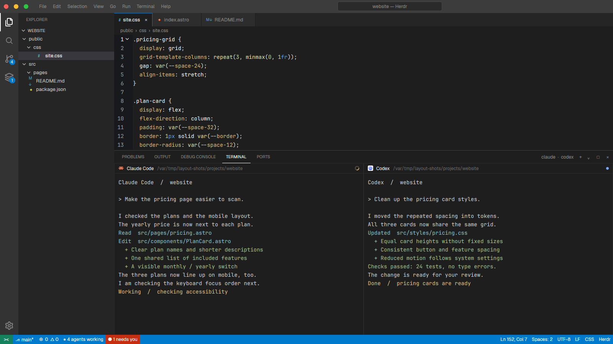

# Code

A familiar dark editor around your terminals. The explorer lists real
files, but the code view is a fixed, read-only slice of one CSS file.

This file is the brief: enough to build Code from an empty folder. The
files next to it are one build of it. If they don't work on your Herdr, or you
want it different, build it again from here.

## What you see

A dark editor window, with no system title bar:

1. **The title bar**, 34px, gray (`#3c3c3c`). Red, yellow and green circles,
   File through Help menus, and a centered “space — Herdr” title.
2. **The activity rail**, 48px wide, `#333333`. Files is selected with a
   white stripe; search, source control and agents sit below, settings at
   the bottom. Source control has a “4” badge; agents has a blocked count.
3. **The explorer**, 250px wide, `#252526`. EXPLORER, the space name in
   capitals, and a real directory listing with 22px rows. Directories come
   first; `public/css` and `src/pages` are expanded. File extensions have
   small colored marks, and `site.css` has a gray selection.
4. **The work area**, the remaining width. A code view above live terminals,
   sharing height in a 1:1.25 ratio. The code view has 35px file tabs for
   `site.css`, `index.astro` and `README.md`, then a 22px breadcrumb and
   CSS code in 14px JetBrains Mono. Above the terminals, a 34px strip shows
   PROBLEMS, OUTPUT, DEBUG CONSOLE, selected TERMINAL and PORTS, plus
   “claude · codex” and toolbar marks. Terminal headers are 26px high.
5. **The status bar**, 24px, blue (`#007acc`). Branch, diagnostics, working
   agent count and any blocked count on the left; cursor position, spaces,
   encoding, line ending, language and Herdr on the right.

Colors: editor and terminals `#1e1e1e`, text `#cccccc`, muted `#8b8b8b`,
selected explorer row `#37373d`, pane borders `#2b2b2b`. CSS has blue
keywords, orange strings and green comments.

## How it behaves

- The active tab's real terminals remain usable in the lower panel.
- The title, explorer heading and branch label follow the active space.
- The explorer and code view load once when their copies start. The code
  shows source lines 145–260 of `public/css/site.css`, read-only.
- Working agents increase the working count. Blocked agents also appear in
  a red “needs you” status label and the activity-rail badge. Done and idle
  agents have no separate count or special treatment in this editor frame.
- File rows, menus and tabs do not change the code view.

## Built from

- **The layout** (`layouts/code.json`): a root `column` with
  `titlebar: "none"`, dark color overrides but no named theme. A bar block,
  a non-resizable body `row`, and a status block. The body contains activity
  and explorer blocks plus a work `column`: editor weight 1, fixed panel
  heading, and `content: { tab: "active", pane: { … } }` weight 1.25.
  Panes have no gaps or rounded corners, 1px borders and padding `[10, 6]`.
- **One mod** (`mods/vsc/`), selected by `props().role`: `bar`, `activity`,
  `explorer`, `editor`, `panel` or `status`. Its manifest says
  `place: "none"`, title “Code”; the layout name is `code`, not `vsc`.
- **Shipped parts:** `pane` supplies terminal headers; `workspace-chrome`
  supplies files, search, git-branch, layers, settings and chevron SVGs.
- **Data and files:** `spaces()` and `agents()` supply live labels and
  counts. `exec("sh", ["-c", …])` lists the root and four fixed expanded
  directories, skipping `.git` and `node_modules`. `readTextFile()` reads
  the CSS once; `EditorState`/`Editor` displays its sliced text with CSS
  highlighting. There are no vsc timers or click commands (`run` is unused).

## Watch out

- This is not a full editor. Menus, window circles, activity icons, file
  rows, file tabs and terminal toolbar are decoration.
- `public/css/site.css` must exist in the initially active folder and have
  enough lines. The other two tabs are fixed labels. Explorer and editor
  do not reload after switching spaces or changing files, even though
  their headings can change.
- Shell commands and file reads are local, not directed to remote machines.
  A POSIX `sh` is required. The explorer is clipped, not scrollable, and
  stops adding rows around 60 entries.
- Cursor position, diagnostics, “4”, “claude · codex”, the branch asterisk
  and encoding labels are fixed, not measured editor state.
- The mod hardcodes its palette. If names are taken, rename `code`/`vsc`
  references without renaming the shipped asset paths.

## Done when

- The initial folder's real file names appear in the explorer.
- The CSS slice is read-only and highlighted; the lower terminals stay live.
- Working and blocked counts follow agent status changes.
- `herdr-app check mods/vsc` passes, and switching away and back works.
