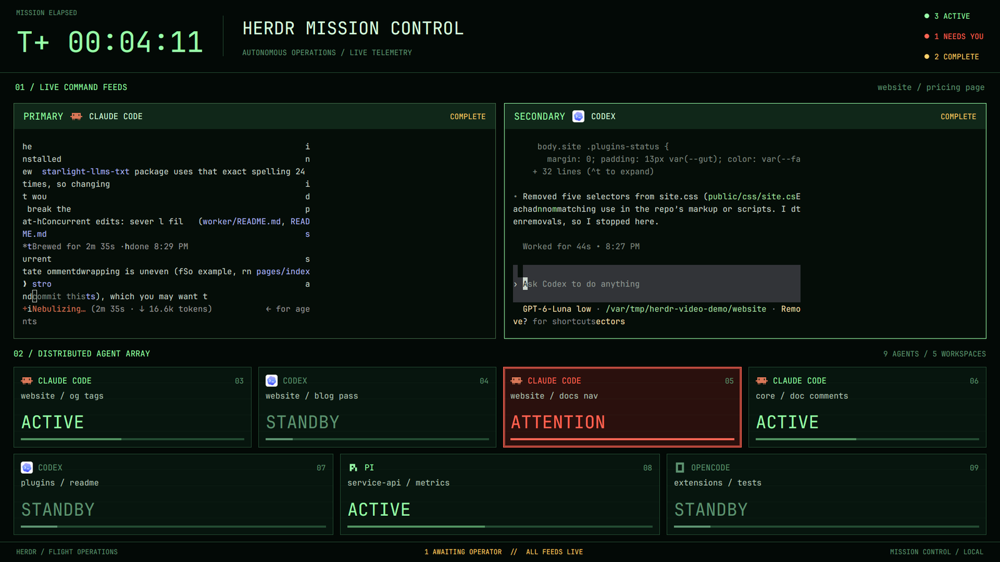

# Mission

A green mission-control screen for your agents. The active tab's terminals
are command feeds; agents in other tabs form a two-row status array below.

## What's in here

- `layouts/mission.json`: elapsed clock and counts, live terminal
  feeds, 278px agent array and footer.
- `mods/mission/`: `props().role` selects `top`, `feeds`,
  `pane`, `grid` or `footer`. Includes preview SVG.

## How it was built

1. `agents()` supplies ACTIVE, ATTENTION, COMPLETE and STANDBY
   states. `spaces()` supplies workspace names and the active tab.
2. A 1s timer updates the top clock. It starts at the earliest matching
   terminal's `created_ms` from `terminals()`, or mod startup.
3. `panes()` labels the first terminal PRIMARY and the others
   SECONDARY. The array excludes agents in the active tab.
4. Array clicks run `agent.focus`; `setAgentOrder` records all agents.
   Blocked borders and working bars pulse with native animations.

## What it assumes

- Only built-in Herdr APIs; no shipped mods or external CLIs.
- `JetBrains Mono` for UI and terminals, `moss` theme with dark
  green and pale green overrides. The mod also hardcodes its palette.
- Bars mean status, not measured progress: working is 45%, idle 12%,
  done and blocked 100%.
- The array shares agents across two rows without scrolling; many agents
  squeeze into the same height and width. “LOCAL” is a fixed footer label,
  not a restriction on which agents appear.
- No existing `layouts/mission.json` or `mods/mission/`; rename
  references and asset paths first if those names are taken.

