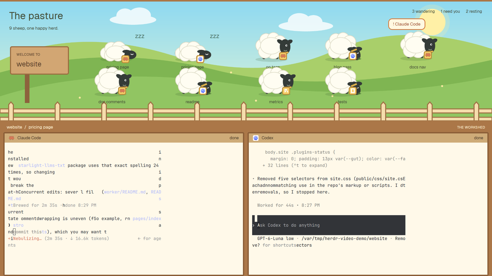

# Pasture

Your agents as a herd of sheep in a meadow. Working sheep wander, idle ones
graze, finished ones sleep, and one that needs you jumps with a bubble over
its head. Click a sheep to open its terminals in the workshed below.

## What's in here

- `layouts/pasture.json`: the window. The pasture on top (85% of the height),
  a wooden rail with the active space and tab, then the active tab's
  terminals in wood-framed panes. Light `paper` theme with warm colors.
- `mods/pasture/`: one mod that draws three things, picked by
  `props().role`:
  - no role: the meadow, the sign with the space's name, the counts
    (wandering, need you, resting) and one sheep per agent;
  - `rail`: the strip under the fence, `space / tab` and "THE WORKSHED";
  - `pane`: each terminal's header, the program's icon, name and status.
  - `meadow.svg`, `sheep.svg`, `graze.svg`, `sleep.svg`: the art.

## How it was built

1. Started from an empty column layout: a block for the pasture, a 29px
   block for the rail, and the active tab's panes with the pasture mod as
   their header (`"header": { "content": { "mod": "pasture", "props": { "role": "pane" } } }`).
2. The meadow is one SVG stretched over the block; the sign, title and
   counts are plain text on top of it.
3. Each agent from `agents()` is a sheep, placed in two rows of five. Its
   status picks the drawing: `working` and `blocked` stand (`sheep.svg`),
   `done` sleeps (`sleep.svg`) with a "zzz", anything else grazes
   (`graze.svg`). The program's icon hangs on a little yellow tag.
4. Motion: a 4.2s timer nudges working sheep left and right and
   `.transition("left")` eases them there; `blocked` sheep bounce with
   `.loop("top")`; grazing ones bob slowly.
5. Clicking a sheep runs `agent.focus` with its terminal, so its space and
   tab open in the workshed.
6. `setAgentOrder` keeps the app's agent order (and the keys that walk it)
   the same as the order of the sheep.

## What it assumes

- Only the app's built-in API: `agents`, `spaces`, `panes`, `props`, `run`,
  `setAgentOrder`. No other mods.
- Ten agents fit (two rows of five). More overlap; add a third row if you
  run more.
- Its own colors in the layout file. It ignores your `settings.json` theme
  on purpose; delete `theme` and `colors` from the layout to use yours.
- No `mods/pasture/` or `layouts/pasture.json` of your own. If you have
  one, rename this one (the mod's folder, its paths in `main.js`, and the
  `mod` names in the layout).

