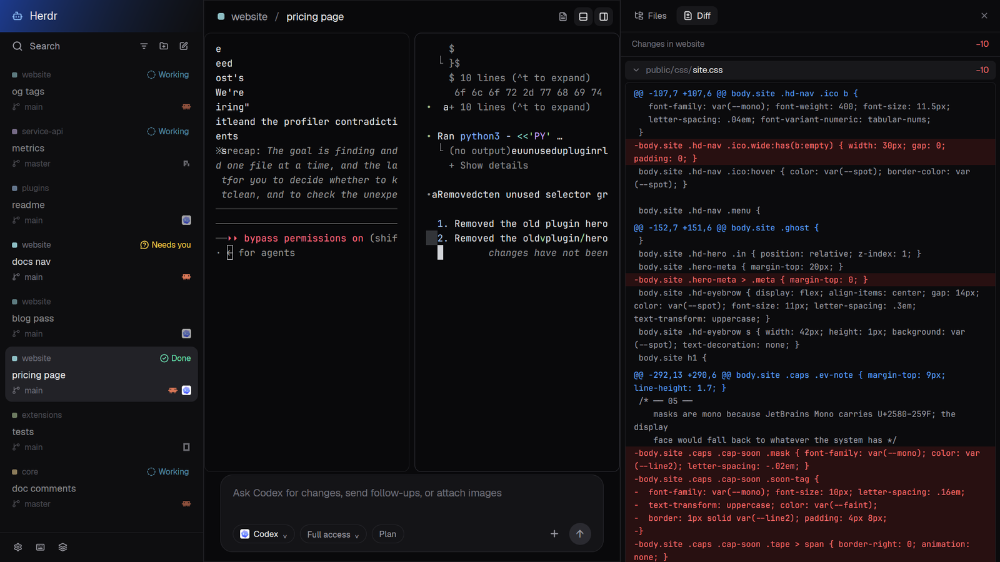

# Threads

Every tab becomes a thread in a project inbox. Pin, snooze or settle work,
send follow-ups below the live terminal, and read files or diffs on the right.

This file is the brief: enough to build Threads from an empty folder. The
files next to it are one build of it. If they don't work on your Herdr, or you
want it different, build it again from here.

## What you see

Three columns, left to right, with no system title bar:

1. **The inbox**, 300px wide (resizable, 220–460px). A 48px blue-to-black
   brand band says Herdr. Search, project filter, add-project and new-thread
   icons sit above a scrolling list. Each thread shows a colored project
   square, project name, optional machine, status or age, tab name, branch,
   up to three program icons and any pull-request badge. Pinned rows come
   first, then open work, with folded Snoozed and Settled shelves below.
   Settings, help and switch-layout icons sit in a 44px bottom strip.
2. **The thread**, the flexible width. A 48px heading shows project / thread
   and details, terminal-drawer and right-panel toggles. Real terminals fill
   the middle, with 8px gaps, 10px corners and 1px borders, no custom headers.
   A 132px composer below has a rounded dark box, agent name, Full access,
   Plan, attach mark and blue send arrow. An optional 280px details card
   sits over the upper-right terminal area.
3. **The right panel**, hidden initially, 560px wide when opened (320–1100px).
   Its 48px heading switches Files and Diff or closes the panel. Files has
   a searchable tree, and a read-only code view beside a 240px tree when a
   file is open. Diff shows file totals and expandable red/green changes.

Colors: background `#09090b`, inbox `#0e0e10`, right panel `#0b0b0d`,
text `#ececee`, muted `#a1a1aa`, borders `#1f1f23`, accent `#60a5fa`.
The new-thread dialog follows the theme. File code uses the settings font;
diff code falls back to JetBrains Mono.

## How it behaves

- Working threads say “Working” with a duration in light blue (`#7dd3fc`),
  blocked ones “Needs you” in yellow (`#fcd34d`), done ones “Done” in mint
  (`#6ee7b7`). Idle/no-status rows show time since their last change, if known.
  Quiet, unselected rows fade; activity does not reshuffle the open list.
- Clicking a row opens its tab; right-click opens its tab menu. Hover reveals
  snooze, pin and Settle. Snooze offers 1 hour, Tonight (19:00), or Tomorrow
  (09:00); a later blocked or done update wakes it early. Shelves unfold on
  click, with Wake or Unsettle on hover. Settling the last open thread in a
  linked worktree offers removal, not automatic deletion.
- Search opens the picker; filter narrows the inbox to one project. Worktrees
  of one repository share a project. A PR badge opens its URL.
- New thread opens a dialog: type a name (up to 48 characters), choose
  project, current checkout/new worktree and Claude, Codex, Pi, Grok or shell.
  Enter starts; Ctrl+P cycles project, Ctrl+W checkout, Ctrl+A agent; Esc cancels.
- Click the composer to type; Enter or the arrow sends trimmed text to the
  focused agent and clears the box. With no agent or no text, nothing sends.
- The terminal drawer first splits a shell below the lead terminal; later
  clicks zoom/unzoom that lead terminal to hide/show its peers.
- Files supports expanding folders, path search and opening read-only files;
  Enter opens the first search match, Esc clears search. Diff expands one
  file at a time, comparing staged and unstaged changes against HEAD and
  including new files. The details toggle currently has a build error below.

## Built from

- **The layout** (`layouts/threads.json`): a resizable root `row`,
  `titlebar: "none"`, `theme: "graphite"`, its own colors and 1px dividers.
  `side` and `center` are columns; `main` uses
  `content: { tab: "active", pane: { … } }` and a floating `details` block.
  Hidden `panel` contains `panel-head` and a `panel-body` stack, initially
  `diff`, with `files` and `diff` children. Terminal padding is `[16, 10]`.
- **Eight mods** (`mods/t4-*/`): `t4-threads` inbox and shared outline SVGs;
  `t4-head` uses `props().part` (`brand` or `crumbs`); `t4-composer` sends;
  `t4-new` is a 640px dialog; `t4-details` is the Git card;
  `t4-panel-head` switches surfaces; `t4-files` and `t4-diff` read files.
  All manifests use `place: "none"`; overlays get `props().overlay`.
- **Shipped parts:** `menu`, `picker`, `worktree`, the
  `workspace-chrome/plus.svg` asset and `icons/agent.svg`.
- **APIs:** `spaces()`, `panes()`, `agents()`, `focused()`, `theme()`,
  `settings()`, `layout()`, `window()`, `home()`, `props()`, `shared()` and
  `setShared()`. Pins, snoozes, project scope, details and space colors use
  persistent `t4.*`/`space.colors` keys; launch choices use `localStorage`.
- **Commands:** `tab.select`, `tab.settle`, `tab.unsettle`, `tab.new`,
  `space.new`, `mod.open`, `pane.split`, `pane.zoom`, `pane.focus`,
  `layout.toggle`, `layout.show`, `layout.select`, `layout.switch`,
  `app.settings`, `app.help` and window minimize/maximize/close through
  `run()`. `openOverlay()`/`closeOverlay()` handle dialogs and menus;
  `hc(["send", address, text])` sends follow-ups. No custom agent order.
- **Programs and files:** `exec()` runs Git discovery/status/list/diff,
  `gh pr list` and a local URL opener (`open`, `xdg-open`, `explorer.exe`).
  Files uses `git ls-files -co --exclude-standard`, or `rg --files` outside
  Git, and `readTextFile()`/`EditorState`. Diff uses `git diff HEAD` and
  reads new files. Operations pass the space/terminal's machine where set.
  Details defines Commit as `git add -A` then `git commit -m`, Push as
  `git push -u origin HEAD`, PR as `gh pr create --fill --web`, and editor
  launch as `code`.
- **Timers:** inbox ticks every 1s, notifying for short working durations or
  every 30 other ticks; PR queue drains every 1.5s with a 180s cache, skipping
  main/master/trunk/develop. Details polls every 4s only when enabled; Files
  every 5s, Diff every 3s. These copies can keep polling while hidden.

## Watch out

- Details references undefined `on` in render. Enabling it can fail before
  the card appears; its editor and Git buttons cannot be relied on as supplied.
  Commit would stage every change, not just one file, if that error is fixed.
- Full access, Plan, attach and the composer's agent selector are decoration.
  The composer handles simple typing/backspace, not a full text editor; it
  clears before send success and does not report send failures.
- New-thread text names the tab/branch; it is not sent as an agent task.
  Launch commands are fixed: install the chosen `claude`, `codex`, `pi` or
  `grok`. Git is required; PR features need authenticated `gh`, non-Git file
  lists need `rg`, and URL opening needs the local system opener.
- Files caps at 5,000 paths, 300 search results and 400,000 text characters.
  Polling refreshes the tree, not an already-open file's contents. Diff caps
  each expanded view at 1,500 lines; new files do not add to its header totals.
- Much of the palette is hardcoded. Persistent shared keys survive layout
  changes. If names are taken, rename all eight mod references, self-opening
  names and `mods/t4-threads/…` paths together, not shipped asset paths.

## Done when

- Tabs appear as threads; selecting, pinning, snoozing, waking and settling
  work, and the project filter narrows the list.
- A new named thread starts the chosen installed program; a follow-up reaches
  the focused agent's live terminal.
- The drawer shows/hides peers, and the right panel switches Files/Diff,
  opens real files read-only and expands real changes.
- `herdr-app check` passes for all eight mods in their default state, and
  switching away and back works. Do not use the broken details card as a
  passing acceptance check.
