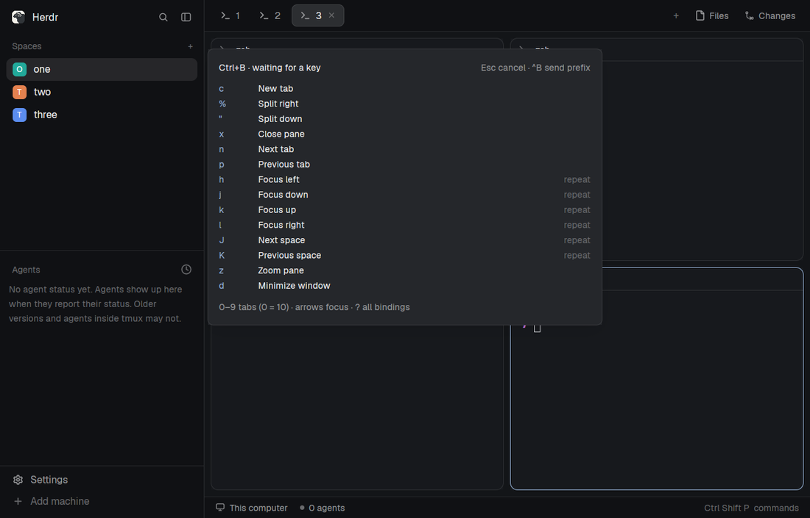

# Tmux prefix

Ctrl+B, then a key: tmux-style shortcuts for Herdr tabs, panes and spaces. A small hint stays open while you decide. This is a piece you add to your current layout, not a whole window or a terminal multiplexer.



This file is the brief: enough to build Tmux prefix from an empty folder. The files next to it are one build of it. If they don't work on your Herdr, or you want it different, build it again from here.

## What you see

- A popup near the top of your window, 520px wide and 420px high, offset 64px from the top. Nothing is added to the layout itself.
- A heading, "Ctrl+B · waiting for a key", with "Esc cancel · ^B send prefix" on the right. After a repeatable action the heading becomes "Repeat · 500 ms".
- A scrollable list, 280px high, with the key on the left, its action in the middle and "repeat" on the right for actions you can repeat. The short list hides arrows and digits; `?` toggles the full list.
- A footer: "0–9 tabs (0 = 10) · arrows focus · ? all bindings".
- Your theme's popup background, foreground text, accent keys and muted hints. Text is 12px; the heading is semibold, with 14px padding around the popup and 8px gaps.

## How it behaves

Ctrl+B opens the hint and waits without a timeout. The next key does this:

| Key | Action |
| --- | --- |
| `c` | New tab |
| `%` / `"` | Split right / down |
| `x` | Close the focused pane and end its terminal |
| `n` / `p` | Next / previous tab |
| `1`–`9`, `0` | Select tab 1–9, 10 |
| `h j k l` or arrows | Focus left / down / up / right; repeatable |
| `J` / `K` | Next / previous space; repeatable |
| `z` | Toggle pane zoom |
| `d` | Minimize the window, leaving programs running |
| `?` | Toggle the full binding list and wait without a timeout |
| Escape | Cancel |
| Ctrl+B | Send a literal Ctrl+B to the focused terminal |

After a repeatable action, you have 500ms to repeat it without another prefix. Each repeat restarts the window: Ctrl+B, J, J, K moves two spaces forward, then one back. A different bound key runs its prefix action and closes the hint unless it is repeatable.

An unbound key after the initial prefix just closes the hint. During the repeat window an unbound simple key goes to the now-focused terminal and closes the hint. Escape always cancels. Outside the hint, typing is untouched. There are no agent-status displays or animations.

## Built from

- **One mod**, `mods/tmux-prefix/`, with `main.js` and `mod.json`. The manifest has `place: "none"` and a top popup overlay, so there is no `layouts/` folder or layout change.
- **A `keys.json` snippet** with three bindings, merged into the person's existing keys rather than replacing them:

  ```json
  {
    "global": { "ctrl-b": "mod.open:tmux-prefix" },
    "terminal": { "ctrl-b": "mod.open:tmux-prefix" },
    "mod:tmux-prefix": { "ctrl-b": "tmux-prefix.send-prefix" }
  }
  ```

  The global binding opens the popup outside a terminal; the terminal binding opens it while a terminal has focus. The mod-specific binding wins while the popup is focused, delivering a command through `nextCommand()` that sends a literal Ctrl+B instead of reopening the popup.
- **A focusable view**, using `gpui-kit` and `gpui-base` for the list and `theme()` for its colors. It takes focus on open, handles raw key events and closes with `closeOverlay(props().overlay)`.
- **Commands:** `tab.new`, `tab.next`, `tab.prev`, `tab.select` (one-based indices), `pane.split`, `pane.close`, `pane.go`, `pane.zoom`, `space.next`, `space.prev` and `window.minimize`, dispatched with `run()`.
- **Literal keys:** `focused()?.terminal` finds the target and `hc(["keys", terminal, key])` sends through Herdr's core, including remote terminal addresses. No external dependencies beyond Herdr and its core.
- **Repeats:** `cx.timer.after` only after repeatable actions, with a generation counter to ignore old timers. `REPEAT_MS` and the `BINDINGS` array at the top of `main.js` are the customization points; each binding is `[key, label, command, args, repeatable]`.

## Watch out

- Ctrl+B is taken away from terminal programs, including tmux. Ctrl+B Ctrl+B reaches them. Preserve other key bindings and resolve conflicting `ctrl-b` entries in the active `layout:<name>` section. Existing app key bindings can win over raw key handling.
- Replay during repeats only supports ASCII letters (including uppercase), digits, spaces, unshifted ASCII punctuation, Enter, Tab, Backspace and arrows. Shifted symbols such as `!` or `+`, Unicode, modified shortcuts and composition aren't replayed.
- Use `key_char` to distinguish `%`, `"`, `?` and uppercase J/K from their unshifted keys.
- `d` minimizes; it is not tmux detach. There is no pane-resize binding because Herdr exposes no pane-resize command.
- The popup has fixed dimensions. Check it fits the person's window.
- Follow the installed `herdr.d.ts` and `gpui-kit.d.ts`, never modify shipped mods, and disclose that this mod runs `hc` to send literal keys.

## Done when

- `herdr-app check mods/tmux-prefix` passes with the matching Herdr binary and home.
- In an isolated home, Ctrl+B opens the hint and a long pause does not close it.
- New tab, both splits, tab selection, pane focus, zoom and minimize do what their labels say.
- J J K repeats move two spaces forward and one back; the hint closes 500ms after the last repeat.
- `?` toggles the full list and stops the repeat timeout. Escape cancels without typing into the terminal.
- Ctrl+B Ctrl+B sends a literal prefix. An unbound simple key during repeats reaches the focused terminal, while one after the initial prefix only dismisses the hint.
- Normal typing and the person's existing layout still work outside the popup.
